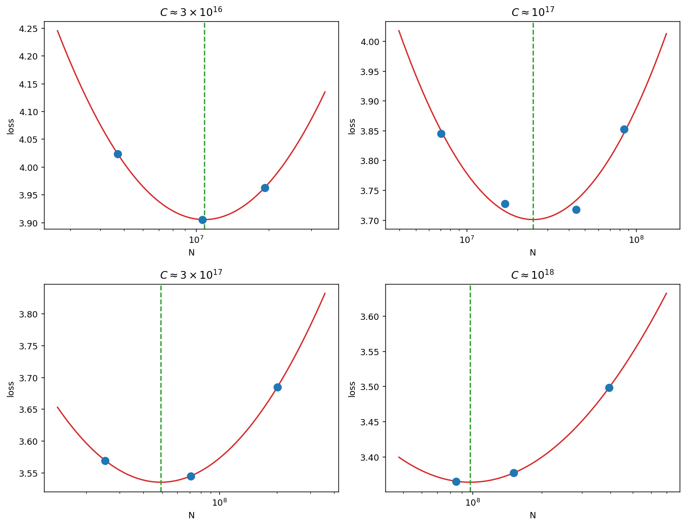
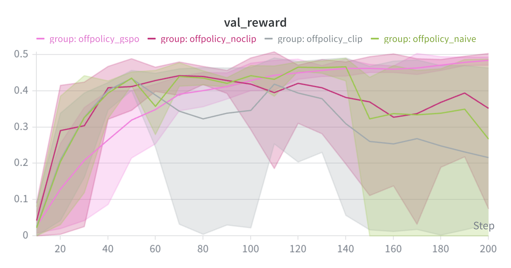

# LLM Training

Pretraining, scaling laws, GPU systems, and reasoning RL in PyTorch.

This repo collects my language-model implementations and experiments: byte-pair tokenization and transformer pretraining, attention and distributed-training systems, data filtering and deduplication, compute-budgeted scaling, and reasoning post-training on OLMo-2-1B.

The components are organized by subsystem rather than by experiment chronology. They are a research workbench, not a production training framework or one continuous model-training run.

## What's here

| Area | Implementation |
| --- | --- |
| Pretraining | BPE tokenizer, transformer blocks, RoPE, RMSNorm, AdamW, checkpointing, training and decoding |
| Systems | Triton attention experiments, distributed data parallelism, sharded optimizer state, profiling and benchmarks |
| Data | Text extraction, language and quality filtering, PII masking, exact and approximate deduplication |
| Scaling | IsoFLOP experiments, model/data allocation fits, and a roughly 1B-parameter training configuration |
| Post-training | Group-normalized rewards, GRPO/Dr.GRPO-style objectives, importance reweighting, response masking, and experiment runners |

## Selected experiments

**Scratch pretraining.** Implemented and trained small transformer language models on TinyStories and OpenWebText, with learning-rate, batch-size, normalization, positional-encoding, and feed-forward ablations. These are separate from the pretrained OLMo checkpoint used for reasoning RL.

**Compute-budgeted scaling.** Compared model sizes at four IsoFLOP budgets from `3e16` to `1e18` FLOPs and fitted compute-optimal model/data allocation curves. Extrapolation to a 48-hour budget initially suggested approximately 1.33B non-embedding parameters. After a memory-limit adjustment, the submitted configuration used 24 layers, width 1920, and a 10.2B-token budget: approximately 1.06B non-embedding parameters under the `12 L d²` estimate. This is a selected configuration, not a claim that its full training run or predicted loss was independently verified.



**Reasoning RL.** Post-trained `allenai/OLMo-2-0425-1B` on GSM8K and compared prompting, group normalization, learning rates, and on-/off-policy updates across three seeds. The experiments also examine response-length collapse and a short-response penalty. Historical results are summarized in [the results metadata](results/experiments.json); they are not a fresh reproduction or a benchmark claim against external models.



## Layout

```text
src/llm_training/
  pretraining/    tokenizer, model, optimizer, training, decoding
  systems/        attention, distributed training, benchmarks
  data/           filtering, deduplication, tokenization
  posttraining/   reasoning-RL utilities and experiment runners
  reference/      attributed Stanford reference model for systems benchmarks
experiments/scaling/
results/          selected figures and scoped historical results
tests/            small CPU smoke tests
third_party/      upstream license notices
```

## Quick start

Python 3.12 is required. From the repository root:

```sh
uv venv --python 3.12
uv pip install -e '.[dev,analysis]'
uv run --no-project python -m pytest
```

The smoke tests exercise tokenizer round trips, transformer forward/backward passes, and RL loss utilities on CPU. They do not reproduce the training experiments. GPU benchmarks and long training runs are never launched by the tests.

Optional dependencies are split into `systems`, `data`, and `posttraining` extras. Triton, CUDA/NCCL benchmarks, and vLLM require appropriate Linux/GPU environments; the CPU smoke tests do not require them.

The pretraining experiment runner expects locally prepared tokenized data under `runs/tokenized/`. Review its configuration before running it. Model weights, datasets, tokenizer artifacts, cloud credentials, and checkpoints are intentionally not distributed.

The historical post-training runner additionally expects the upstream `checkpoint.py`, `vllm_utils.py`, and prompt assets from [the original infrastructure](https://github.com/stanford-cs336/assignment5-alignment). These are not redistributed because the inspected upstream snapshot has no repository-level license covering them. Place them in `src/llm_training/posttraining/` and its `prompts/` directory for local use; those paths are gitignored. The reusable RL loss functions can be used without them.

## Scope and provenance

The code and experiments originated in Stanford CS336 and are repackaged here by functionality. My scratch model is in `pretraining/`; the attributed Stanford model used by systems benchmarks is kept separately in `reference/`. This distinction is intentional.

The original handouts, full assignment reports, grading tests, API credentials, training data, and Git histories are excluded. Scaling reference curves supplied by Stanford are labeled separately from my own experimental results. CUDA/distributed functionality and complete training reproductions are not covered by the small CPU test suite.

See [NOTICE](NOTICE) and [LICENSE](LICENSE). The math grader retains its Apache-2.0 license and upstream credits; Stanford reference/scaffolding components retain their MIT notices.
